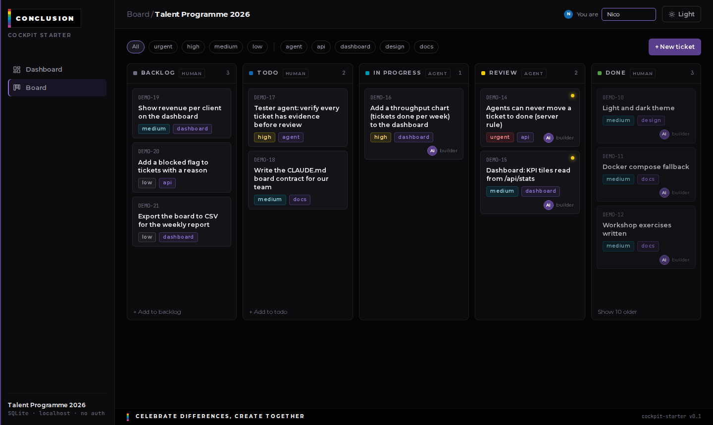
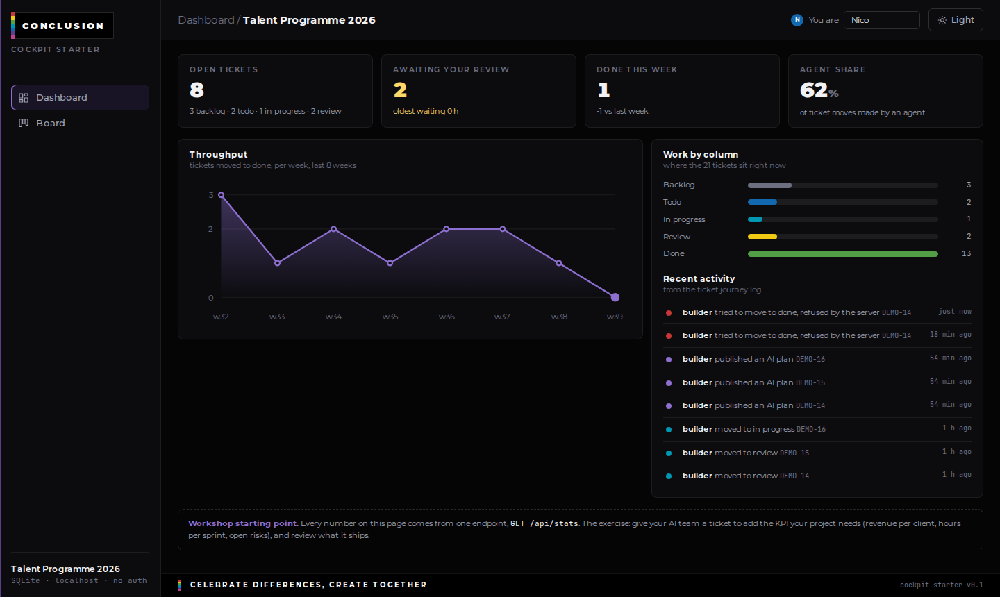

# Cockpit Starter

A small command board for an AI-assisted project team, in the Conclusion cockpit look.
Kanban with an enforced lifecycle, a dashboard that reads from it, and a contract your
AI agents follow. Built as the hands-on kit for the *AI in projectwerk* training.





## Run it

The easy way, and the way the workshop starts: open your AI assistant in this folder and say

> Read START.md and get the application running for me.

- **Claude Code**: run `claude` in this folder.
- **GitHub Copilot**: open the folder in VS Code, open Copilot Chat and switch it to agent mode.

The assistant checks Node, installs, starts the app, and tells you where to click next.
All prompts for the workshop, step by step: [docs/copilot-prompts.md](docs/copilot-prompts.md).
On Windows, use Git Bash as the terminal (VS Code picks it for you through `.vscode/settings.json`).

By hand:

```bash
npm install
npm run dev
```

Open http://localhost:3000. The database is created and seeded on first start.
No accounts, nothing leaves your machine.

Prefer Docker? `docker compose up --build`, same URL.

## What is in the box

| | |
|---|---|
| **Board** | `backlog -> todo -> in_progress -> review -> done`, drag and drop, filters |
| **Ticket** | Request (human) · AI Plan (agent, before code) · Result (verdict + evidence) · Journey (every move, with actor) · Comments |
| **Dashboard** | open work, review queue, throughput per week, agent share, activity feed, all from `GET /api/stats` |
| **The rule** | an agent can never move a ticket to `done`; the server refuses and logs it |
| **API** | plain REST, `docs/api.md`, addressable by ref (`DEMO-7`) |
| **Agent contract** | `AGENTS.md`, read by Claude Code (through `CLAUDE.md`) and GitHub Copilot (also through `.github/copilot-instructions.md`) |
| **Example agents** | project-manager (talks to you, writes tickets) and builder (works one ticket), in `.claude/agents/` for Claude Code and `.github/agents/` for Copilot |
| **Workshop** | in the app under *Oefening instructie* (Dutch), and `docs/workshop.md` |

Stack: Next.js 16, React 19, Drizzle, SQLite via `@libsql/client` (no native build step), Tailwind v4.
Dark by default, light mode in the top bar.

## Make it yours

- `.env.local`: `PROJECT_NAME` and `TICKET_PREFIX`
- `src/lib/kanban.ts` `getStats()`: add your own numbers, they show up in `/api/stats`
- `src/app/page.tsx`: put them on the dashboard
- `.claude/agents/` and `.github/agents/`: add roles to your team (same text in both, one file per tool)

## Reset

Stop the server and delete `data/cockpit.db`. Next start reseeds the demo board.
